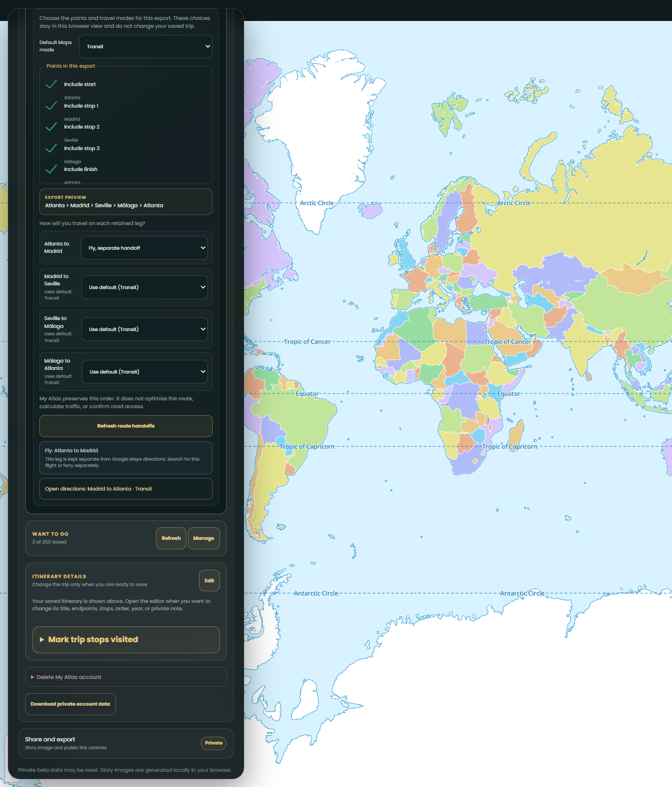
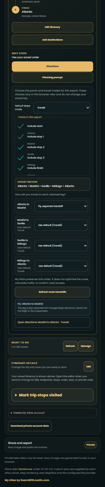

# My Atlas directions Phase 2 audit, 2026-11-18

This audit covers the local Phase 2 branch based on the completed Phase 1
planner presentation. It verifies repository behavior and an in-memory compiled
component fixture. It does not establish a deployment, authenticated staging
acceptance, or real-device Google Maps behavior.

## Implemented boundary

- Start, saved stops, and the effective finish can be included or excluded from
  one browser-only export. A final-stop finish remains one logical point instead
  of becoming a duplicate coordinate.
- The visible default supports Drive, Transit, Walk, and Bike. Every retained
  adjacent pair can use that default or an explicit Maps mode.
- Fly and Ferry are explicit route boundaries. They do not create a road route,
  provider deep link, airport guess, booking request, or commerce event.
- Removing a point creates a new adjacent pair that visibly uses the current
  default. It cannot silently inherit an override from an older pair.
- One retained physical point opens a readable Google Maps place search. Zero
  points produce no handoff. A start and finish at the same place also collapse
  to a search instead of a zero-distance route.
- Consecutive pairs with the same Google Maps mode form an ordered route group.
  Longer groups retain overlapping endpoints while splitting at no more than
  three intermediate waypoints and rejecting URLs beyond 2,048 characters.
- Custom coordinates are previewed and require explicit confirmation before
  entering a Maps search or directions URL. Private plan titles, notes, wish
  IDs, place IDs, and account identifiers do not enter those URLs.
- Export preferences and prepared links live only in Vue component memory.
  They call no account mutation, change no Worker contract, and do not refresh
  saved-plan retention.

## Automated evidence

The focused planning suite verifies point filtering, retained order, all four
Google Maps modes, fly and ferry boundaries, mixed-mode splitting, one-point
search, zero-point handling, same-place collapse, newly bridged default modes,
custom-coordinate confirmation, conservative waypoint segmentation, and URL
privacy and length limits. Source assertions verify that preference handlers do
not call the API, mutation flow, plan save, or planning refresh.

Lint passed after restoring native select visibility inside the planner. The
restoration is necessary because the legacy global Materialize stylesheet hides
native `select` elements. The full production build also passed, including the
content, analytics, commerce, AdSense, My Atlas boundary, and 33 Durable Object
tests.

## Local visual evidence

The screenshots use the real compiled planner component with an in-memory
owner fixture and a mixed Fly plus Transit export. No API request is made.
Chromium measured zero horizontal overflow at 1,280 and 390 CSS pixels. Native
default and per-leg mode selectors, point controls, the route preview, the
separate flight boundary, and the Google Maps action remain usable at both
sizes.

## External verification still required

- Review the controls with a real authenticated owner session.
- Complete keyboard and screen-reader acceptance.
- Open representative search, Drive, Transit, Walk, and Bike links in Google
  Maps on Android, iOS, and desktop.
