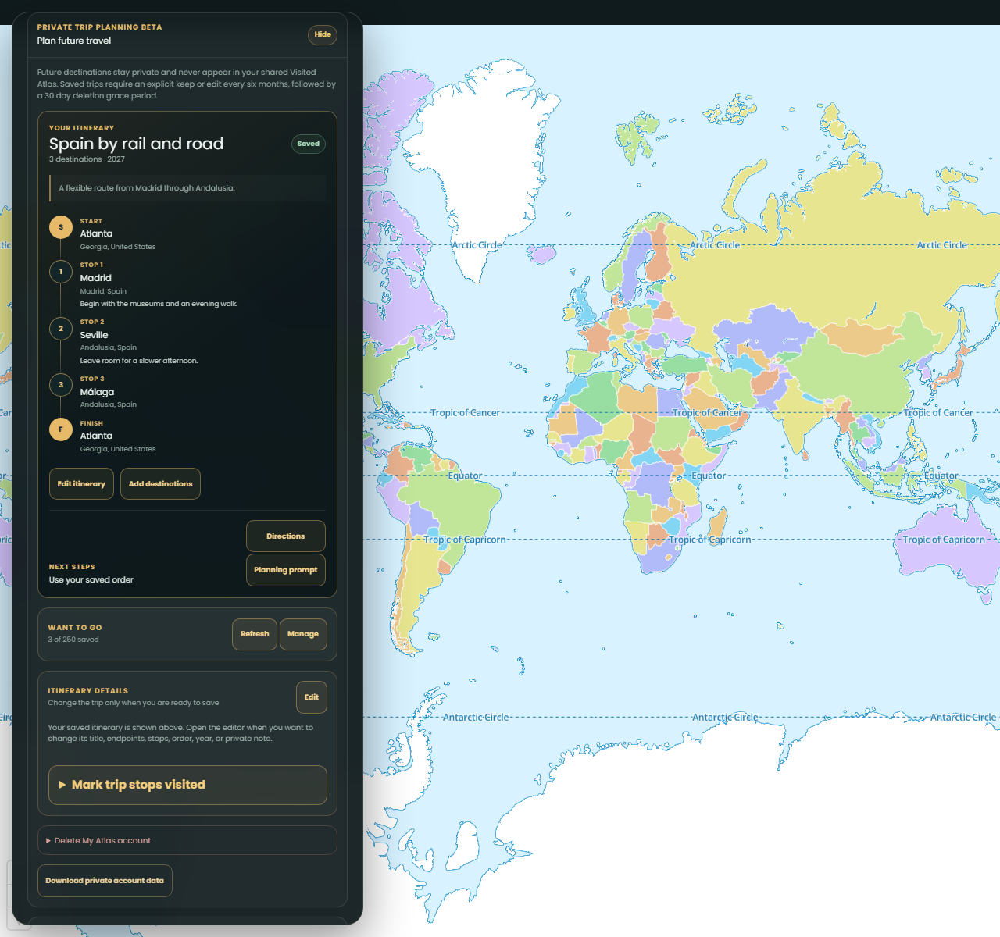
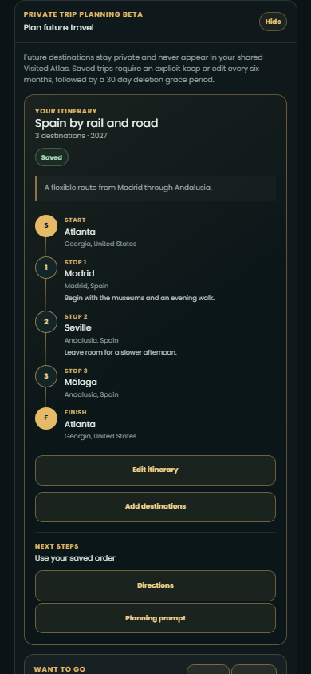

# My Atlas trip planner Phase 0 audit, 2026-11-18

This audit used merged baseline `fc69cd0` on `origin/main`. It records
repository behavior only. It does not establish a deployment, authenticated
owner acceptance, real-device Maps behavior, merchant permission, or external
provider behavior.

## Existing contracts

- One owner-private plan supports up to 50 unique ordered wishlist stops.
- Start and selected finish may use a wishlist entry, catalog place, or custom
  coordinates. End mode may be final stop, return to start, or selected finish.
- Snapshots preserve location data and an optional `sourceWishId`, but no
  stable itinerary-occurrence ID exists.
- Mark Visited uses `stopIndex`; duplicate stop wish IDs are rejected.
- All mutations use the account-global revision, strong `If-Match`, and UUID
  idempotency key. Stale writes return `revision_conflict`.
- Plans use six-calendar-month confirmation and a 30-day deletion grace.
  Maps and prompt handoffs are browser-only and do not refresh retention.
- Account export includes the current plan; permanent account deletion erases
  it. Public projection enumerates visited pins, not wishes or plans.
- Google Maps handoffs are driving-only, preserve order, split at three
  intermediate waypoints, and reject URLs beyond 2,048 characters.
- `/my-atlas` is excluded from GA4. Existing Expedia offers are public
  Journey-only and cannot be treated as private-planner approval.

## Phase 1 boundary

The first redesign can remain entirely inside the planner presentation and
error-copy paths. It needs no Worker, Durable Object, request, response,
export, retention, authentication, map, analytics, or partner-registry change.

The prior controls-first view exposed the destination manager, complete plan
editor, Mark Visited, directions, and prompt controls in one long surface. The
approved first phase makes the saved itinerary primary and collapses secondary
editing and destination-management controls. Existing Up and Down ordering,
Mark Visited, directions, prompt, export, deletion, and retention actions are
retained.

## Concurrency finding

The Worker correctly rejects a stale mutation. Before this phase, the recovery
message told the owner to refresh, while a refresh could replace a locally
edited itinerary draft. The client may safely fetch the latest revision after
the rejected write because the failed mutation changed no state. It must keep
the draft where possible and require the owner to review and explicitly save
again. It must never automatically replay the mutation.

## Deferred work

- Maps include and exclude preferences, route modes, one-point search, and
  mixed-mode splitting remain Phase 2.
- Stable node IDs, persisted legs and stays, and v2 Mark Visited input remain
  Phase 3.
- The private map overlay, flight assistant, stay planner, and any commercial
  activation remain separate later phases.
- Authenticated responsive, keyboard, screen-reader, and real-device owner
  acceptance remains external verification.

## Local visual evidence

The following screenshots use the real compiled planner component with an
in-memory owner fixture. They do not call the API or establish authenticated
staging acceptance. Desktop Chromium measured a 1,280-pixel viewport with zero
horizontal overflow. Phone-width Chromium measured a 390-pixel viewport with
zero horizontal overflow. The saved itinerary, endpoint hierarchy, collapsed
secondary forms, and focused next actions remained visible at both sizes.

